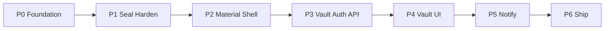

# Keynest — Phased Improvement Roadmap

**Status:** Planning  
**Scope:** Ordered path from today’s skeleton to a shippable Manager + embeddable tools platform.  
**Companion:** [PRODUCT.md](./PRODUCT.md) (north star), ADRs in this folder.

This roadmap locks sequencing and design choices so work does not thrash between UI polish, crypto hardening, and vault features.

---

## Current baseline (as of this doc)

| Area | State |
|---|---|
| Docs / ADRs | Product vision + crypto/stack/Seal/policy ADRs landed |
| Libs | `keynest-seal`, `keynest-policy`, `keynest-generate` with unit tests; Seal golden vectors landed |
| Manager API | Tools + auth + vault CRUD; Spring Boot 4 on Java 21 |
| Manager Web | Angular 21 LTS; register/login + vault UI; custom dark forest theme |
| Deploy | API Docker + Compose with Postgres; Vercel for Angular |
| CI | GitHub Actions: Maven on JDK 21/25, Angular build |

Documented MVP remainder (from PRODUCT): Material shell → notify → full Compose polish → sample external consumer.

---

## Locked decisions

| Topic | Decision |
|---|---|
| UI kit | **Angular Material** for Manager interaction primitives; theme tokens map to existing Keynest palette (Fraunces / IBM Plex / forest greens). Default indigo Material chrome is rejected. |
| Marketing vs app chrome | Landing/brand surfaces stay custom CSS. Material is for forms, dialogs, lists, snackbars, menus inside authenticated Manager flows. |
| Seal before storage | No production vault persistence until Seal v1 has golden vectors + `rewrap` ([ADR-0003](./ADR-0003-keynest-seal.md)). |
| Crypto open path | Manager MVP uses **server-side** `open`; envelope stays client-openable later (ZK / WebCrypto) without format break. |
| Auth recovery (MVP) | **Reset wipes vault** — explicit UX copy. Downloadable recovery key is a post-MVP follow-on. |
| Lib distribution | Reactor / path modules until APIs stabilize; Maven Central later. |
| Tools HTTP sidecar | Deferred until a non-JVM consumer appears. |

---

## Phase overview

P0 and P1 can overlap lightly (CI does not block Seal tests). P2 starts after Seal API surface for `rewrap` is stable enough to theme against, and **must finish before** P4 so vault screens are not built twice. P3 depends on P1. P4 depends on P2 + P3.

---

## Phase 0 — Foundation gates

**Goal:** Make every later change safe to land and review.

### Deliverables

1. **CI** — `.github/workflows/ci.yml`:
   - `mvn -B test` (libs + manager-api)
   - `npm ci && npm run build` in `apps/manager-web`
2. **Threat model stub** — [`THREAT_MODEL.md`](./THREAT_MODEL.md) **(landed — #15)**: assets (master password, envelopes, DEKs), trust boundaries (browser / API / DB), abuse cases (brute force, demo-key leakage, log scraping). Expand before public release (#43).
3. **Tools API security baseline**:
   - Gate tools seal/open behind `keynest.tools.demo.enabled` **(landed — #16)**; `docker` profile defaults off and ships no demo hex. Local demo path documented in README.
   - Rate-limit `/api/v1/tools/validate` and auth register/login **(landed — #17)** via `RateLimitFilter` + `ApiPaths.RATE_LIMITED_POSTS`; defaults and env overrides documented in README.
4. **Environment config** — Angular `environments` + `API_BASE_URL` token **(landed — #18)**; see [`VERCEL.md`](./VERCEL.md). Dev default remains `http://localhost:8080/api/v1`; production builds use `src/environments/prod.ts`.

### Exit criteria

- CI green on main.
- Threat model file exists and lists seal/open and auth as in-scope. **(done — stub)**
- No production/`docker` profile ships a fixed **tools demo** hex DEK. **(done — #16)**; vault DEK still tracked as #30.

---

## Phase 1 — Seal and policy hardening

**Goal:** Lock the crypto contract before Manager stores envelopes.

### Deliverables

1. **Seal v1 golden vectors** — deterministic test vectors for `seal` / `open` / `fingerprint` (fixed key, nonce fixture or documented test double) in `libs/keynest-seal`.
2. **`rewrap(envelope, oldKey, newKey)`** — implement + tests; document AAD/`policyId` binding in ADR-0003 appendix if layout fields change.
3. **Policy depth** — `explain(policy)` for UI copy; richer banned-list / denylist coverage; keep generate↔validate invariant.
4. **Sensitive buffer hygiene** — clear intermediate `byte[]`/`char[]` where practical after seal/open/hash.

### Exit criteria

- Golden vectors fail the build if envelope layout drifts.
- `rewrap` round-trip tests pass.
- PRODUCT MVP item “Harden libs” checked off in spirit (link from README success criteria).

---

## Phase 2 — Angular Material shell (Keynest-themed)

**Goal:** Product chrome and design tokens before vault screens.

### Deliverables

1. Add `@angular/material` + Angular CDK matching Angular 19.
2. **Theme** — custom Material theme (Sass or CSS variables) mapped to existing tokens in [`styles.css`](../apps/manager-web/src/styles.css) / brand colors (`#0c1410`, `#c6e2cf`, Fraunces mark). Dark color-scheme preserved.
3. **App shell** — router outlets, layout with brand mark, primary nav placeholders: Tools | Vault | Account.
4. **Migrate tools demo** — health / generate / validate use Material form fields, buttons, snackbars; keep non-card hero/brand treatment on the tools landing section.
5. Shared UI primitives only as needed: confirm dialog, inline error, password field with reveal.

### Exit criteria

- Routes exist; tools demo is a routed page, not the entire `AppComponent` blob.
- Visual identity still reads as Keynest without Material indigo defaults.
- No vault CRUD yet (that is P4).

---

## Phase 3 — Manager API: auth + vault + Postgres

**Goal:** Persist sealed credentials behind authenticated users.

### Deliverables

1. **Postgres** — schema for `User`, `VaultItem` per [PRODUCT domain model](./PRODUCT.md); Flyway/Liquibase migrations.
2. **Auth** — register/login using `PasswordHasher` (Argon2id); JWT or opaque session; rate limits; explicit “reset wipes vault” account recovery stub.
3. **Vault use cases** — create/read/update/delete items; passwords only as Seal envelopes; `policyId`, `expiresAt`, `lastRotatedAt`.
4. **Key handling** — server DEK/KEK from env/KMS-style config (no demo hex); AAD binds `policyId` (+ user/item ids as decided in Seal docs).
5. **Thin controllers** — validate → use case → libs → DTO; no Spring types inside `libs/*`.
6. **Compose** — add `postgres` service to [`deploy/docker-compose.yml`](../deploy/docker-compose.yml); wire Spring datasource profile.
7. **Tests** — MockMvc/WebTestClient for auth + vault happy paths and unauthorized access.

### Exit criteria

- Authenticated CRUD stores only envelopes at rest.
- Tools generate/validate remain available; seal/open for vault go through vault use cases (not the demo tools key).
- External integrators still depend only on public lib APIs (Manager dogfoods them).

---

## Phase 4 — Manager Web vault CRUD

**Goal:** Usable vault UX on the Material shell.

### Deliverables

1. Auth screens (register / login / logout) with Material inputs; brand-first layout without packing the viewport with secondary chrome.
2. Vault list + create/edit/delete; reveal password via authenticated API `open` (server-side).
3. Generate-on-create / validate-before-save wired to existing tools endpoints or vault-specific use cases.
4. Expiry fields displayed; guided rotate action calling generate + re-seal (notify in P5).
5. Error/empty states and loading via Material progress/snackbar patterns already themed in P2.

### Exit criteria

- End-to-end: register → create item → reveal → update → delete against Compose API + DB.
- Angular e2e or component tests for critical vault flows (at least auth guard + list load).

---

## Phase 5 — Expiry notify

**Goal:** Manager differentiator — warn before password age/expiry.

### Deliverables

1. Scheduler/outbox scanning `VaultItem.expiresAt` / `notifyBeforeDays` / policy `maxAgeDays`.
2. Email adapter (dev: Mailhog/console; cloud: provider config).
3. UI: upcoming expiry list + “rotate now” deep link into P4 rotate flow.
4. Tests for outbox state machine (pending → sent / failed).

### Exit criteria

- Local Compose path can demonstrate a due notification without a real ESP.

---

## Phase 6 — Ship path and embeddable proof

**Goal:** Close the platform story.

### Deliverables

1. Full Compose: Postgres + API + web (or documented Vercel web + Compose API).
2. **Sample external consumer** Maven module (e.g. `examples/external-consumer`) depending on seal/policy/generate only — proves tools-without-Manager.
3. README success criteria updated; publish notes for GitHub Packages (Central still later).
4. Threat model pass expanded for release; rate limits and logging review (no secrets/envelopes plaintext in logs).
5. Manual GitHub rename `fep-password` → `keynest` (operator checklist item).

### Exit criteria

- PRODUCT success criteria satisfied: sample consumer seals/validates/generates; Manager CRUD uses libs only; Compose path documented and runnable.

---

## Explicit non-goals (unchanged)

Browser extension, org RBAC, breach monitoring, Bitwarden parity, custom ciphers, SMS-only MFA — see PRODUCT non-goals.

---

## Suggested execution slices (for implementation PRs)

| Slice | Phase | PR focus |
|---|---|---|
| A | P0 | CI + env API URL + threat model stub |
| B | P1 | Golden Seal vectors + `rewrap` |
| C | P2 | Angular Material theme + router shell + tools page migrate |
| D | P3a | Postgres + User/auth |
| E | P3b | Vault CRUD API |
| F | P4 | Vault UI |
| G | P5 | Notify outbox + email |
| H | P6 | Sample consumer + Compose polish |

Do not start slice F before C and E. Do not start E before B.

---

## Traceability

| Roadmap phase | PRODUCT MVP item |
|---|---|
| P0 | Supports all later items; security non-negotiables |
| P1 | “Harden libs (golden Seal vectors, richer policies, rewrap)” |
| P2 | Enables “Manager Web vault CRUD UI” without redesign |
| P3 | “Manager API vault + auth persistence (Postgres)” |
| P4 | “Manager Web vault CRUD UI” |
| P5 | “Notify — email on approaching expiry” |
| P6 | “Compose full stack + cloud notes” + “Publish libs / sample external consumer” |
