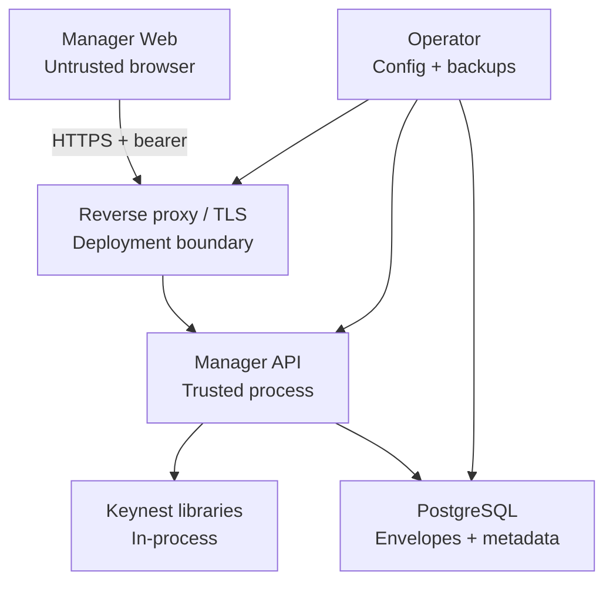

# Keynest threat model

**Status:** Release review accepted in maintainer-approved PR #81; refresh against the final release commit

**Snapshot:** `3e203bb` (November 11, 2026)

**Review trigger:** Revisit for every new trust boundary, authentication or key-custody change, and before a public release.

**Companions:** [Product](./PRODUCT.md), [AI architecture](./AI_ARCHITECTURE.md), [database migration runbook](./DATABASE_MIGRATIONS.md), and ADRs [0001](./ADR-0001-crypto-model.md), [0003](./ADR-0003-keynest-seal.md), [0006](./ADR-0006-manager-vault-key-and-aad.md), [0007](./ADR-0007-session-token-storage-and-browser-transport.md), and [0008](./ADR-0008-versioned-database-migrations.md).

This is a source-informed threat model for the implemented Keynest libraries and Manager. It is not a penetration-test report, independent audit, compliance attestation, or proof that a deployment is secure.

## Scope and evidence

In scope:

- `keynest-seal`, `keynest-policy`, and `keynest-generate` library behavior;
- Manager registration, login, logout, session authentication, and rate limiting;
- vault list, read, create, update, delete, and bounded secret reveal;
- tools endpoints, including development-only seal/open;
- PostgreSQL/H2 persistence, Flyway upgrades, backup, and restore expectations;
- browser-to-API transport, CORS, trusted proxies, logging, and runtime configuration.

Not implemented and therefore not claimed as protected surfaces: BYOK AI provider access, agent/MCP tools, notification delivery, MFA, organization RBAC, recovery keys, and client-side zero-knowledge open. Their intended boundaries are included only as release gates so they cannot be added without a focused ADR and negative tests.

Evidence reviewed for #43:

- application configuration, controllers, services, repositories, filters, and crypto-library paths at the snapshot above;
- the accepted ADRs and security regression tests landed through PR #80;
- a source scan for logger use, console output, stack-trace printing, request/response logging, and sensitive field names; the only console call found is Angular's bootstrap-failure `console.error`;
- rate-limit path coverage and proxy-identity behavior;
- the PostgreSQL migration and legacy-schema verification added by #79/#80.

## System and trust boundaries

The API and libraries are one trust zone. Compromise of the API process exposes configured key material and the server-side open path. Encryption at rest does not defend against that compromise.

| Boundary | Required assumption | Failure consequence |
| --- | --- | --- |
| Browser → edge/API | TLS terminates only at an operator-controlled endpoint; allowed origins are exact | Bearer or revealed-secret theft, response tampering |
| Direct peer → API | Forwarding headers are ignored unless the direct peer is in an explicit trusted CIDR | Rate-limit identity spoofing |
| API → database | Private authenticated network; least-privileged DB credential; backups protected | Envelopes, account hashes, session digests, and sensitive metadata disclosed or modified |
| Operator → runtime | Secrets supplied outside source control; demo values never used for deployment | Universal vault disclosure or service impersonation |
| API → future providers | No boundary exists yet; outbound AI/notification traffic is disabled until designed | Provider credential or user-data egress |

## Security objectives

1. Plaintext vault passwords, master passwords, raw session bearers, vault keys, and future provider credentials never appear in durable storage, logs, telemetry, prompts, or model output.
2. An authenticated user can access only their own vault rows; existence of another user's row is not disclosed.
3. Seal v1 integrity, algorithm, key ID, and canonical AAD bindings fail closed when modified.
4. Authentication and reveal endpoints minimize brute-force, caching, browser-persistence, and proxy-spoofing exposure.
5. Schema changes and key-dependent data are recoverable through reviewed, tested migrations and operator backups.
6. Deterministic server code—not a model, client, or proxy header—decides authorization and policy enforcement.

Availability against a large distributed denial-of-service attack, protection from a malicious host/operator, zero knowledge, hardware-backed key custody, and organization-grade isolation are not current guarantees.

## Assets and data classification

| Asset | Classification | Storage / handling |
| --- | --- | --- |
| Master password and candidate passwords | Critical secret | Request memory only; Argon2id hash persisted for the master password |
| Vault plaintext | Critical secret | Created/opened in API memory; AES-256-GCM envelope persisted |
| Vault key and demo key | Critical secret | Runtime configuration/process memory; never database state |
| Raw session bearer | High secret | Returned once and held in browser `sessionStorage`; never persisted server-side |
| Session digest and password hash | High security data | Database; not authentication responses or logs |
| Envelope bytes and backups | High security data | Database/backup; confidentiality depends on separation from key material |
| Email, label, URL, username, policy, timestamps | Sensitive metadata | Currently plaintext in database and API responses scoped to the owner |
| IP address and actor/resource identifiers | Sensitive telemetry | Use only when operationally necessary and subject to retention controls |

## Threat register

Risk describes the remaining release concern after the listed implemented controls. `Open` means a documented control or operational verification is still required; it does not mean the scenario is currently exploitable.

| ID | Threat | Implemented controls | Residual risk / required action | Risk |
| --- | --- | --- | --- | --- |
| T01 | Login brute force and account enumeration | Argon2id verification; generic login failure; bounded per-identity login/register limiter | Registration still distinguishes an existing email; limiter is per JVM. Add edge/shared enforcement for multi-replica deployment and decide enumeration semantics | Medium, open |
| T02 | Bearer theft through XSS or malicious dependency | 256-bit opaque bearer; tab-scoped `sessionStorage`; seven-day expiry; logout revocation; legacy `localStorage` cleared | JavaScript can read the bearer. Add CSP/dependency hardening and reassess HttpOnly cookies with CSRF/CORS before public Internet deployment | High, open |
| T03 | Database disclosure yields active sessions | Only SHA-256 token digests are stored; raw bearers have 256 bits of entropy | A live bearer stolen elsewhere remains usable until logout/expiry; expired-session cleanup is not implemented | Low |
| T04 | Cross-tenant vault access or existence leak | Every item lookup uses `(id, userId)`; foreign keys preserve ownership; list/read/reveal/update/delete negative tests cover two users; misses return 404 | Repeat these tests for new export, search, notification, agent, and admin paths | Low |
| T05 | Envelope substitution, tampering, or wrong-context open | AES-256-GCM; versioned owner/item/policy AAD for new and resealed rows; unknown AAD versions fail closed; golden/negative tests | Legacy null-version rows bind only policy ID until password update/reseal | Medium, open migration debt |
| T06 | API process or host compromise exposes every vault item | Key is separate from DB; deployed profiles reject missing/demo key; buffers are cleared best-effort | One server-wide key and server-side open make process compromise critical. KeyProvider/per-user wrapped DEKs require a future ADR and migration | High, accepted MVP limitation |
| T07 | Database or backup disclosure exposes metadata | Secrets remain envelopes; password hashes use Argon2id; token digests are not bearers | Labels, URLs, usernames, emails, timing, and policy metadata are plaintext. Encrypt/minimize metadata only through a versioned design; protect backups separately from keys | Medium, open |
| T08 | Demo key or demo decrypt endpoint reaches production | Docker profile has no key default; demo key requires explicit opt-in and is rejected under `prod`/`production`; tools seal/open are disabled by default in Docker | Compose contains public local credentials and key material by design. Never publish that topology unchanged; verify active profiles and config at startup | Medium, operational |
| T09 | Forged forwarding headers bypass throttling or exhaust limiter memory | Direct peer used by default; explicit trusted CIDRs; right-to-left hop resolution; header/hop/map bounds | Per-instance fixed windows are not distributed and may permit aggregate abuse; trusted proxy ranges can be misconfigured | Medium, open |
| T10 | Public tools become password oracle or secret-ingestion surface | Validate is rate-limited; demo seal/open gated; no application request logging | Validate/hash/verify accept secret candidates and generate returns a secret. Document intended exposure, bound request sizes, and consider authentication or deployment-level restriction | Medium, open |
| T11 | Logs, traces, errors, or support artifacts leak secrets | No Java application logger calls or body-logging middleware at reviewed snapshot; Angular only reports bootstrap failure; no raw tokens/envelopes/plaintext are intentionally logged | Framework debug logging, proxy access logs, APM auto-capture, heap dumps, or future code can reintroduce leakage. Enforce the logging rules below and review every sensitive PR | High, open process control |
| T12 | Migration or rollback corrupts/loses data | Flyway checksummed migrations; Hibernate validation; H2 legacy-upgrade and PostgreSQL 16 integration tests; backup/preflight/single-instance runbook | V2 is not application-only reversible; untested operator backups or loss of the vault key make envelopes unrecoverable. Complete a restore rehearsal before release | High, open release gate |
| T13 | Oversized/malformed requests or expensive crypto cause denial of service | Selected auth/tools endpoints are rate-limited; validation rejects malformed domain input | Request-size limits, timeouts, concurrency bounds, and global/edge limits are not explicitly configured; Argon2 and parsing paths are resource intensive | Medium, open |
| T14 | CORS/TLS/proxy deployment error exposes API | Exact configured CORS origins; bearer sent in `Authorization`; no cookie-auth CSRF surface; forwarding headers untrusted by default | TLS is external; wildcard headers are allowed for configured origins; origin lists and proxy topology need deployment verification | Medium, operational |
| T15 | Vulnerable dependency or build workflow compromises release | Java/Angular builds run in CI; version policy is documented | Dependency update automation, CodeQL/SAST, SBOM, artifact signing/provenance, and pinned third-party actions are not yet release evidence | High, open release hardening |
| T16 | Future AI/provider/agent feature leaks secrets or grants model authority | No provider or agent runtime is currently implemented; architecture forbids secret-bearing model context and model-authorized permissions | BYOK custody/egress and agent identity/scope/plan-apply/audit ADRs plus negative tests are mandatory before implementation or enablement | High, gated |
| T17 | Future notifications copy plaintext into an outbox/provider | Notification runtime is not implemented | Outbox payload must contain references/minimal metadata only; adapters need redaction, retry, SSRF/egress, and provider-secret controls | Medium, gated |

## Logging and diagnostic-data policy

The health hardening in #82 opts in only read-only Actuator health access, hides components/details, disables discovery and JMX exposure, and separates process liveness from database readiness. Integration tests cover database failure/recovery and diagnostic endpoint denial. This limits HTTP diagnostic disclosure; operator-supplied configuration and telemetry still require deployment verification.

The #43 Java source review found no `Logger`, `@Slf4j`, `System.out/err`, `printStackTrace`, application request/response logging, or code that deliberately records passwords, plaintext, envelopes, keys, authorization headers, or tokens. Manager Web retains Angular's generated bootstrap-failure `console.error`; it does not log HTTP payloads. Spring/Flyway/Hibernate startup logs still exist, and deployment infrastructure may add access logs or telemetry outside this repository.

Never record:

- request or response bodies on auth, tools, vault, provider, agent, export, or notification routes;
- `Authorization`, cookies, raw or digested session tokens, password hashes, password candidates, generated secrets, plaintext, envelope bytes/Base64, vault keys, provider credentials, or recovery material;
- URL query strings when they may contain user input;
- email, vault label, target URL, username, or full IP address by default;
- decrypted heap dumps, database snapshots, or failing fixtures in CI artifacts and PR comments.

Permitted security events use an allowlist: stable event name, UTC timestamp, outcome/reason code, route template, deployment instance, and opaque actor/resource identifiers only when necessary. Do not use record/object `toString()` on sensitive request, entity, envelope, or configuration types. Correlation IDs must be random and must not reuse credentials or user data.

Production operators must keep HTTP body/header capture and framework request-detail logging disabled, omit query strings and sensitive headers from proxy access logs, restrict actuator exposure, protect diagnostics with separate access controls, disable or tightly control heap dumps, define retention, and test redaction in the actual telemetry stack. A future audit implementation requires its own schema and tests; this review does not claim a durable audit log.

## Verification before public release

- Run Java 21/25, Angular, PostgreSQL, migration, tenant-isolation, AAD, session, reveal-cache, and proxy tests on the release commit.
- Re-run the logging scan and review every new log/metric/trace field introduced after this snapshot.
- Exercise login abuse through the real reverse proxy and confirm the resolved client identity and shared/edge limits.
- Verify TLS, exact CORS origins, inactive demo tools, non-demo vault key, restricted actuator endpoints, request-size/time limits, and sanitized access logs in the release topology.
- Restore a database backup and its separately preserved vault key, then reveal a pre-backup item and record only pass/fail evidence.
- Scan dependencies and container images; produce an SBOM and resolve release-blocking findings.
- If AI, agents, or notifications are included, attach their accepted ADRs and focused egress, redaction, authorization, replay, and failure-path evidence. Otherwise keep them disabled and describe them as future work.

## Residual-risk decisions

The maintainer must explicitly accept or resolve T02, T06, T11, T12, T15, and any newly introduced high-risk item before a public release. T16 and T17 are feature gates: absence of their design and tests means those features do not ship. Medium operational risks require documented deployment checks and honest known-limitations notes.

Any change to encryption/AAD, key custody, authentication/session transport, authorization, reveal/export, logging/telemetry, migrations/backups, provider egress, or agent capabilities must update this model or state why its assumptions and risk ratings remain valid.
